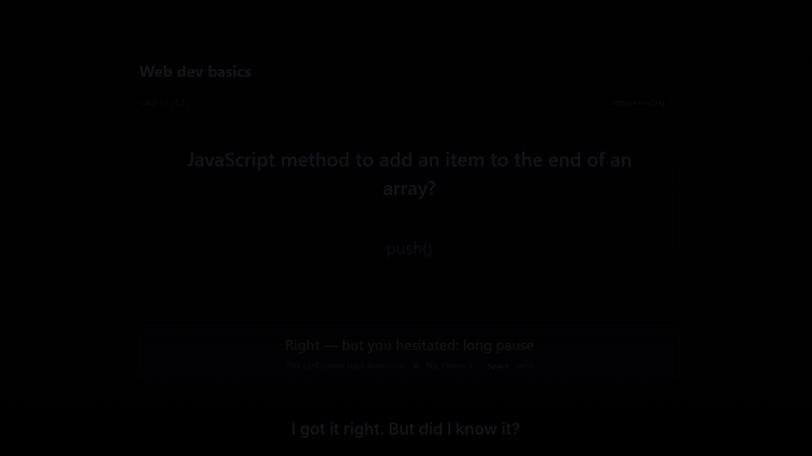
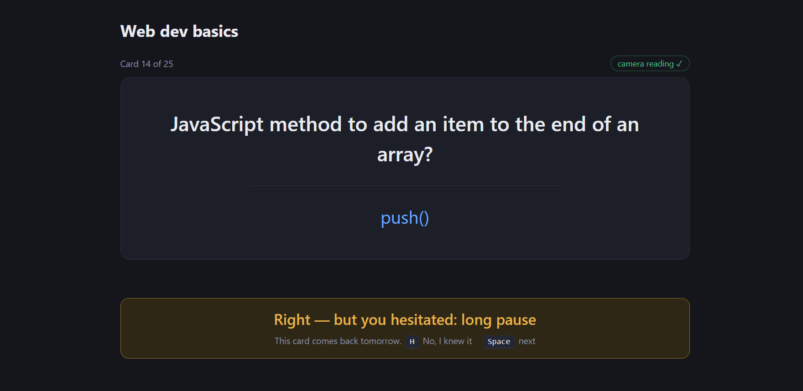
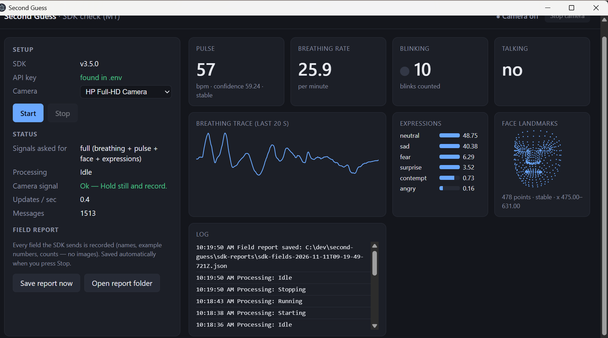
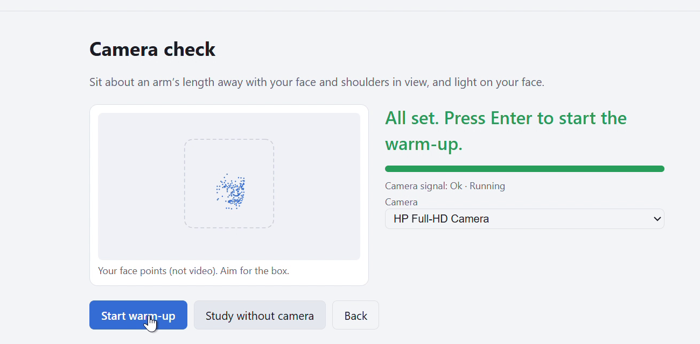
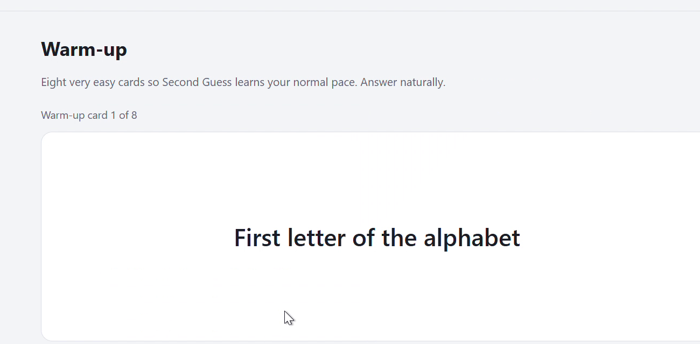
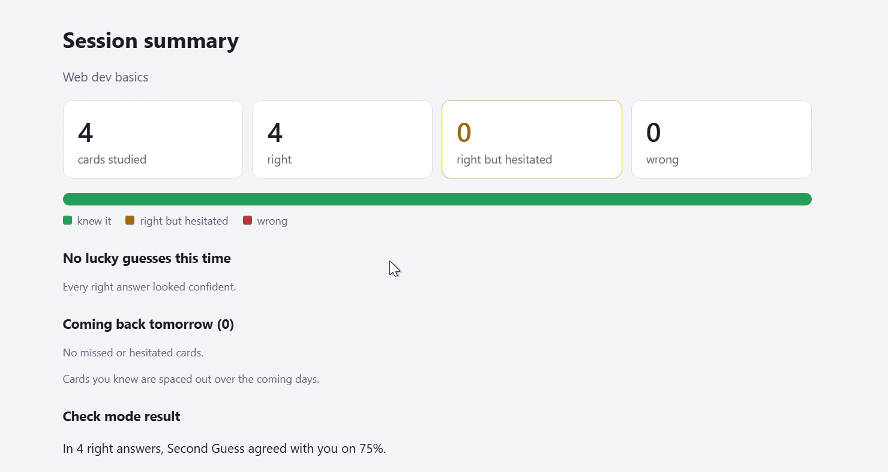
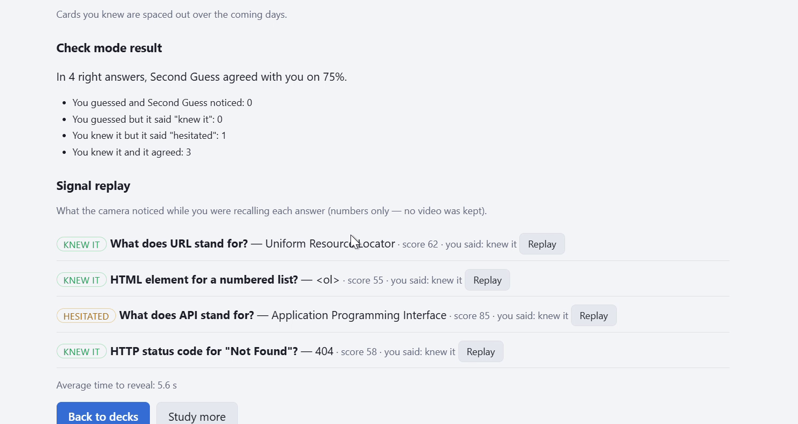
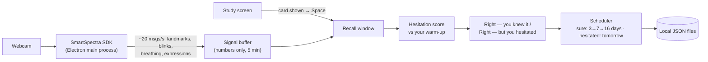

# Second Guess

**Second Guess helps students find the answers they only guessed right, without trusting their own over-confident self-ratings.**

A desktop flashcard app that watches for hesitation *while you recall* an answer — using your webcam and the [Presage SmartSpectra SDK](https://github.com/Presage-Security/SmartSpectra). When a right answer was really a guess, it says **"Right — but you hesitated"** and brings that card back tomorrow instead of next week.



| | |
|---|---|
| 🎬 **Demo video (1:27)** | https://youtu.be/Bw7pHNqaJRY |
| 💻 **Download (Windows)** | [Second-Guess-1.0.0-portable.exe](https://github.com/softalpha0/second-guess/releases/latest) — one file, no install. See [Download](#download-windows) |
| 📝 **DEV post** | https://dev.to/softalpha_0/second-guess-flashcards-that-notice-when-youre-guessing-4d9n |
| 🧾 **Evidence** | [docs/evidence](docs/evidence/) — SDK field report from a real run, honest accuracy results, test results |

Built for the **Presage SmartSpectra SDK Challenge** on DEV · categories: Best Thoughtful Real-World Use, Most Creative or Delightful Use.

> ⚠️ Second Guess measures study hesitation — not stress, emotion or health. It is not a medical device.

---

## The problem

Spaced-repetition apps (Anki, Quizlet, Brainscape) decide when you see a card again from **your own rating** of how well you knew it. People overrate lucky guesses. A guess gets scheduled like real knowledge, pushed a week away, and forgotten — and students find out in the exam.

## The solution

The time between seeing a question and revealing the answer is the **recall window**. Second Guess watches it with the SmartSpectra SDK — a long pause, looking away, a held breath, a burst of blinks, a change of expression — and compares each signal with **your own 60-second warm-up**. Right but hesitant? You see the reason in plain words, and the card comes back **tomorrow**. Disagree? Press **H**.

1. **Agree** to camera use — nothing starts without consent, nothing is recorded.
2. **Camera check** with plain hints ("Move a little closer") and a face-points mirror instead of video.
3. **Warm up** with 8 easy cards so the app learns *your* normal.
4. **Study** with the keyboard: `Space` reveals, `→` right, `←` wrong.
5. **Summary**: which right answers were guesses, why, and what comes back tomorrow.

## Screenshots

All taken from the real app on my laptop with a real webcam.

| | |
|---|---|
|  **A caught guess** — right, but a long pause → back tomorrow |  **Live SDK signals** — breathing, blinks, expressions, 478 face points (numbers only) |
|  **Camera check** — plain hints and a face-points "mirror", no video |  **60-second warm-up** learns your normal pace |
|  **Session summary** |  **Check mode result and signal replay** |

## Features (what works now)

| Feature | Status |
|---|---|
| Consent screen + camera check with plain hints | ✅ |
| Built-in decks (30 cards each, our own) + CSV and Anki import | ✅ |
| Keyboard study loop | ✅ |
| 60-second personal warm-up | ✅ |
| Hesitation score with plain reasons | ✅ — accuracy still being tuned, see [Results](#results-honest) |
| Scheduling that brings guesses back sooner, with override (`H`) | ✅ |
| Session summary | ✅ |
| Works without a camera or key (plain flashcards) | ✅ |
| Check mode: measures how often it agrees with you | ✅ |
| Signal replay for a card | ✅ |
| Progress over days, CSV export, light/dark theme, shortcut overlay (`?`) | ✅ |
| Settings: threshold, signals on/off, camera, API key, delete all data | ✅ |
| Windows download (portable `.exe`, no install needed) | ✅ |

## How it responds to human signals (use of the technology)

Every signal is compared with **your own warm-up**, never a fixed number.

| Signal | SDK source | What counts as hesitation | Weight |
|---|---|---|---|
| Long pause | app timing | Much slower than your pace on this deck (long questions get a reading allowance) | 55 |
| Looking away | `face.landmarks` (478 points incl. irises) → head + eye direction | Away from your usual direction for > ~1 s | 30 |
| Breath hold | `breathing.upperTrace` | Trace nearly flat for 2–4 s | 20 |
| Blinking | `face.blinking` | A burst, or none when some were expected | 15 |
| Expression | `face.expression` (8 scores) | Moving away from your resting face | 15 |
| Pulse | `cardio.pulseRate` | Not used per card: it updated ~2×/minute on a laptop webcam | 0 |

The weighted sum is a 0–100 score (threshold 50, adjustable). The two biggest contributors become the reasons you see. **If the camera view is poor, the card isn't judged** ("no reading") and is scheduled normally.



## Results (honest)

In **Check mode** the app asks "Was that a guess?" after each right answer, hides its own verdict, and compares.

> In a first test of **16 right answers** of my own study, Second Guess **caught all 5 of my guesses** at the default threshold — but it also flagged **8 of the 11 answers I actually knew**, so it agreed with me about **half** the time.

That's a cautious trade-off for now — a false alarm costs one extra review tomorrow, a missed guess costs you in the exam — but it's not good enough yet, and I'm saying so. Full numbers and what changed because of them: [docs/evidence/check-mode-results.md](docs/evidence/check-mode-results.md). Run `npm run tune` to measure it on yourself.

## Challenges

- **Pulse was too slow for one card.** The M1 spike logged every field the SDK sends: pulse arrived twice in 77 seconds, so it got weight 0 instead of a fake signal.
- **The warm-up was too easy.** "2 + 2" takes a second; real cards take longer even when known, so every answer looked like a long pause (Check mode showed 48 points on known cards). Recall time is now compared with your pace on the real deck.
- **Looking away pointed the wrong way** for me — I glance at the keyboard when I'm *sure*. Check mode caught this; it's the next signal to re-tune.
- **The SDK needs the internet while running.** A network drop stops the camera; the app now says exactly why and offers "Turn camera back on" instead of failing silently.

## Consent and data handling

- The camera starts only after a consent screen; a **Camera on** indicator and **Stop camera** button are always visible.
- **No video, frames or images are stored or sent by Second Guess.** The app never subscribes to the SDK's video output. Per card it keeps only the hesitation score, the reasons and the recall time.
- The SmartSpectra SDK processes the camera on this computer and connects to Presage's servers to check the API key and download its models (requests are linked to the key, so not anonymous). **SDK telemetry is turned off** (`enableTelemetry: false`); per Presage's [Telemetry & Privacy](https://github.com/Presage-Security/SmartSpectra/blob/main/docs/telemetry-and-privacy.md) page, telemetry never includes frames or measured values anyway.
- Study data stays in local files (`%APPDATA%\second-guess`). **Settings → Delete all data** removes it, including the saved API key.
- No AI services are used by the app. No health claims.

## Tech stack

| Part | Choice | Why |
|---|---|---|
| App | **Electron + TypeScript**, Vite for the window | Presage's official Electron path; desktop webcam access |
| Signals | **@smartspectra/node-sdk 3.5** in the main process, native camera 1280×720@30 | Camera keeps running even if the window is busy; key never reaches the window |
| Logic | Pure functions in `src/core` (hesitation, scheduler, baseline, signals, import) | Unit-tested with **Vitest** (104 tests) |
| Storage | Local JSON files; API key encrypted with Electron safeStorage (Windows DPAPI) | No database, no cloud |
| Charts / replay | Hand-written SVG | No chart library needed |
| Installer | electron-builder (NSIS) | One-file Windows download |

```
src/core/      hesitation.ts · scheduler.ts · baseline.ts · signals.ts · deck-import.ts · summary.ts …  (pure, tested)
src/main/      main.ts · sdk.ts (SDK session) · store.ts (JSON) · keystore.ts (encrypted key)
src/renderer/  screens: decks · consent · camera-check · warmup · study · summary · progress · settings
decks/         capitals.csv · spanish.csv · webdev.csv
test/          Vitest tests for src/core and storage
docs/          evidence/ · screenshots/ · video/ · dev-post.md
```

## Download (Windows)

1. Download **`Second-Guess-1.0.0-portable.exe`** from the [latest release](https://github.com/softalpha0/second-guess/releases/latest). It's one file (~140 MB) — no installation.
2. Double-click it. Windows may show **"Windows protected your PC"** because this hackathon app isn't code-signed: **More info → Run anyway**. The first start takes a few seconds while it unpacks.
3. **Settings → Presage API key**: create a free key at [physiology.presagetech.com](https://physiology.presagetech.com/) and paste it (stored encrypted on your computer).
4. Pick a deck and study. No key or webcam? It still works as plain flashcards.

Needs Windows 10/11 (64-bit), a webcam and an internet connection. Your study data is kept in `%APPDATA%\second-guess`.

## Run it locally

Requires Node.js 22+, a webcam and a Presage API key.

```bash
git clone https://github.com/softalpha0/second-guess.git
cd second-guess
npm install
cp .env.example .env   # add SMARTSPECTRA_API_KEY (or paste the key in Settings later)
npm start
```

`.env.example` lists the variables: `SMARTSPECTRA_API_KEY` (required for the camera), `SMARTSPECTRA_CAPI_PATH` (optional, only for unusual install paths).

| Command | What it does |
|---|---|
| `npm test` | Runs the automated tests |
| `npm run probe` | Checks the SDK without a window (45 s) and writes a field report to `sdk-reports/` |
| `npm run tune` | Shows how well each threshold matched your Check-mode answers |
| `npm run dist:portable` | Builds the portable Windows `.exe` into `release/` (works on Windows and Linux) |
| `npm run dist` | Builds the installer + portable `.exe` (the installer needs Windows) |

**Keys:** `Space` reveal / next · `→` / `←` right / wrong · `H` change the verdict · `Y` / `N` Check mode · `?` all shortcuts.

## How it fits the judging criteria

| Criterion | Where to see it |
|---|---|
| **Use of the technology** | Five SDK signals (landmarks incl. irises, blinking, breathing trace, expressions, validation status) turned into a per-card score against a personal baseline; SDK validation codes become plain camera hints; an M1 spike logged every SDK field on real hardware ([evidence](docs/evidence/)) |
| **Usability & UX** | Keyboard-only study, plain-language reasons, one-key override, "no reading" instead of guessing when the view is poor, no-camera mode, light/dark theme |
| **Originality & creativity** | Physiological signals used not for health but to catch a lucky guess and fix spaced-repetition scheduling; Check mode measures its own accuracy honestly |

## What's next

- Re-tune with more Check-mode data: lower "looking away" (it points the wrong way for some users) and learn each user's weights from their own Y/N answers.
- A longer, varied warm-up so the personal baseline matches real cards from the first card.
- Import/export to Anki so the "hesitated" verdicts can feed an existing deck.

## Team

[softalpha0](https://github.com/softalpha0) — solo. Built during the challenge with Claude Code (AI coding assistant) from a written PRD; every feature was tested on my own laptop and webcam.

## License

[MIT](./LICENSE)
