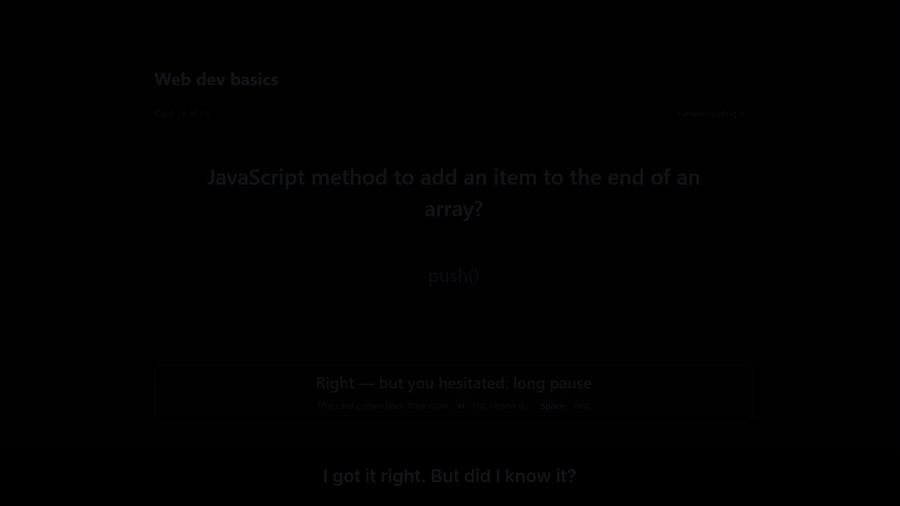
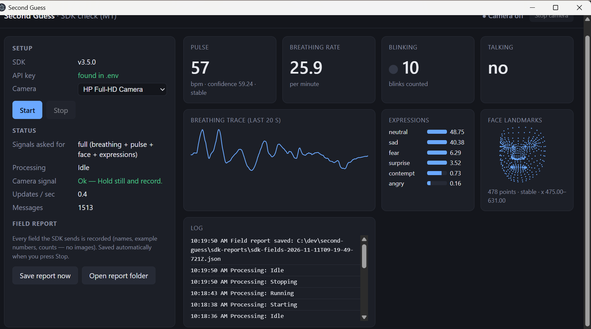
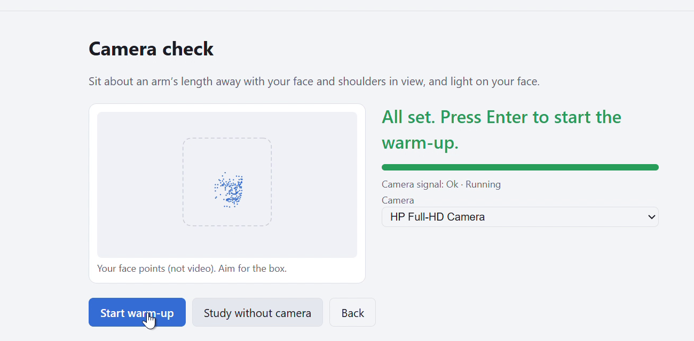
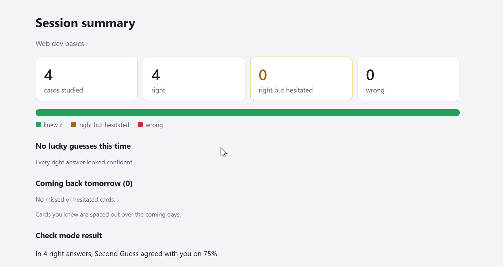
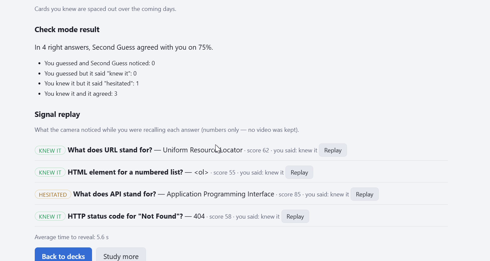

*This is a submission for the [Presage SmartSpectra SDK Challenge](https://dev.to/challenges/presage).*

<!-- Fill every [BRACKET] before publishing. Keep the agreement number honest. -->

## What I Built

Flashcard apps decide when you'll see a card again from **your own rating** — and people overrate lucky guesses. A guess gets scheduled like real knowledge, pushed a week away, and forgotten before the exam.

**Second Guess** watches for hesitation *while you recall* an answer. When you get a card right but hesitated, it says so — **"Right — but you hesitated: long pause, looked away"** — and brings that card back **tomorrow** instead of next week.

## Demo



## Code

[GitHub repo: https://github.com/softalpha0/second-guess]

## How It Responds to Human Signals

The **recall window** is the time between the card appearing and pressing Space. During it, the SmartSpectra SDK (running in Electron's main process on the native camera) provides about 25 readings per second of face landmarks (478 points including the irises), blink detection, the chest-breathing trace and expression scores. Second Guess turns them into a few weak signals and compares each with **your own 60-second warm-up** — never a fixed number:

| Signal | What counts as hesitation | Weight |
|---|---|---|
| Recall time | Much slower than your warm-up pace (log scale; long questions get a reading allowance) | High (55) |
| Looking away | Head or eyes away from your usual direction > ~1 s | Medium (30) |
| Breath hold | Breathing trace nearly flat for 2–4 s | Medium (20) |
| Blinking | A burst of blinks, or none when some were expected | Medium (15) |
| Expression | Moving away from your resting face | Low–medium (15) |
| Pulse | Not used per card (weight 0): it updated ~2×/minute on my webcam | 0 |

The weighted sum is a 0–100 score; 50+ means "hesitated", and the two biggest contributors become the plain-language reasons. **If the signal is poor** (face lost, too dark, camera stopped), the card is marked "no reading" and scheduled normally — no guessing about the guesser.

You can always disagree: **H** flips the verdict, and overrides are counted. A signal replay shows exactly what was noticed for any card.

### Does it work? Check mode

In Check mode the app asks "Was that a guess?" after each right answer and hides its own verdict.

> In **[N]** right answers of my own study, Second Guess agreed with me on **[X]%** — it caught **[a] of [b]** of my guesses, with **[c]** false alarms.

[One honest sentence about where it struggles, e.g. "It misses guesses I make quickly with a straight face."]

## Prize Categories

- **Best Thoughtful Real-World Use** — it fixes a real flaw in spaced repetition, with consent, no recording, and honest measurement.
- **Most Creative or Delightful Use** — physiological signals used not for health, but to catch a lucky guess.

## Consent and Data Handling

- The camera starts only after a consent screen that explains what's measured, kept and sent. A **Camera on** indicator and **Stop camera** button are always visible.
- **No video, frames or images are stored or sent by Second Guess.** The app never subscribes to the SDK's video output. Per card it keeps only the hesitation score, the reason labels and the recall time — in local JSON files.
- The SmartSpectra SDK processes the camera on the computer. It connects to Presage's servers to verify the API key and download its models (requests are linked to the key). **SDK telemetry is off** (`enableTelemetry: false`); per Presage's Telemetry & Privacy page, telemetry never includes frames or measured values anyway.
- **Settings → Delete all data** removes history, schedule, imported decks, settings and logs.
- No health claims: it measures study hesitation — never stress, emotion or health. No AI services are used.
- No camera or key? It works as plain flashcards, with a clear notice.

## Agent Session

Built with Claude Code from a PRD. The riskiest part went first: an SDK "spike" that logged every field the SDK sends on my PC — which is how we found the 478-point mesh with iris points (great for "looked away") and that pulse arrives too rarely for one card.

Two real prompts:
- [PROMPT 1, e.g. "read CLAUDE.md and the PRD, explain your plan in plain language and wait for approval"]
- [PROMPT 2]

All scoring and scheduling logic is pure, unit-tested TypeScript ([99] tests).
